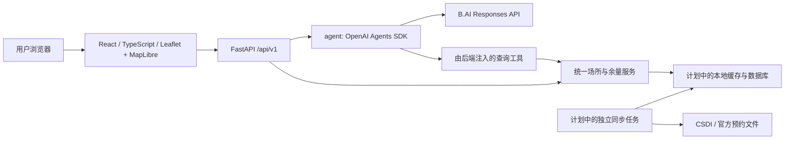

# HK SportFinder 架构规划

状态：第一阶段骨架。当前能力与后续规划以本文件中的状态说明为准。

## 1. 边界与运行方式

采用单仓库、独立前端、一个 Python 后端进程。`agent/` 是后端使用的 Python 包，
通过 OpenAI Agents SDK 运行，不单独部署为微服务。

Agent 不反向 import 后端，也不通过 HTTP 调用本机 API。后端以 callable 注入数据工具。
地图 API 与 Agent 使用同一份业务服务，避免两套场所数据或余量判断规则。
LLM 负责理解条件与解释；距离计算、数据匹配、时间过滤和余量判定由确定性代码执行。

## 2. 技术选择

| 层 | 第一版选择 | 理由与状态 |
| --- | --- | --- |
| 前端 | React + TypeScript + Vite | 已建立可编译骨架 |
| 地图 | Leaflet + MapLibre + OpenFreeMap Positron | 已支持拖动、缩放及点击后定位；尚无设施标记 |
| HTTP API | FastAPI + Pydantic | 已建立版本化路由与模型 |
| Agent | OpenAI Agents SDK / Responses | 已接好工具注入与对话接口，沿用此前测试的 B.AI 提供商 |
| 存储 | 规划 SQLite + GeoJSON 快照 | 适合首批少量图层；本阶段尚未建库 |
| 同步 | 规划独立命令/任务进程 | 不在每个 Uvicorn worker 内启动定时器 |
| 部署 | 规划静态前端 + FastAPI 同域代理 | 当前仅提供本机开发方式 |

不需要先引入 Redis、向量数据库或多个 Agent。后续数据量或空间查询变复杂时，再评估 PostGIS。

## 3. 数据模型与真值规则

### 设施

保留每条来源记录的 `source_id` 与 `source_record_id`，用二者生成稳定记录 ID。
统一字段：中英文名称、地区、运动类型、经纬度、球场数量、来源与同步时间。
当前 Python `Venue` 模型提供基本字段；来源更新时间与跨图层合并关联将在接入时补全。

同名不自动合并。先保留原始记录，再依据官方标识、地址和位置建立可追溯的合并关联。
在合并规则验证前，不展示“全港独立场所总数”。设施类别与运动类型分开建模：
“体育馆”不能等同于“羽毛球”，一个场所可能支持多项运动。

GeoJSON 使用 WGS84，坐标顺序为 `[longitude, latitude]`；Leaflet 数组使用 `[latitude, longitude]`，MapLibre API 使用 `[longitude, latitude]`。
缺失或不合法坐标的记录保留质量标记，不猜测坐标。代表点不默认为入口。

### 预约余量

后续 slot 模型至少包含：场所/场地单元、运动类型、日期、起止时间、余量、来源、采集时间。
时间在界面按 `Asia/Hong_Kong` 解释；存储使用带时区时间戳。

- `available`：在明确的场馆、运动、日期和时段内，有有效发布数据证明余量大于 0。
- `unavailable`：同一查询范围有有效发布数据证明余量为 0。
- `unknown`：无公开数据、未覆盖、未接入、缺字段、过期或读取失败。

`remaining: null` 与 `remaining: 0` 必须区别。不能把某一个时段满场扩展成全天已满。
过期阈值须在读取实际预约文件并明确发布时间语义后设定，不在骨架中随意设定。
所有余量状态都不代表现场占用情况。

## 4. 数据接入流程（后续实现）

1. 读取 FeatureServer 图层元数据，确认 ID 字段、字段名、空间类型、分页能力与最大返回数。
2. 读取原始数据及计数；处理分页、返回截断和 `exceededTransferLimit`。若 offset 分页不可用，
   考虑先取 object IDs 再分批查询，比较原始计数与获取记录数。
3. 按图层编写字段适配器，统一地区、运动分类、坐标和来源 ID，并记录无法映射的字段。
4. 对比质量指标：原始记录、有效坐标、缺失名称、重复来源 ID 和图层内/跨图层重叠。
5. 校验完成后原子替换缓存；失败时保留上次成功快照并标注陈旧状态。
6. 预约文件采用独立适配器，先核对官方场馆/场地 ID，再关联设施；无法匹配的记录不能硬配。

设施与预约使用不同同步频率。五分钟是用户研究确认的预约发布频率，实际下载与覆盖仍待验证。
设施同步频率根据来源更新信息确定。浏览地图或每次向 AI 提问都不触发全量下载。

## 5. 接口契约

当前已实现：

| 方法 | 路径 | 内容 |
| --- | --- | --- |
| GET | `/api/v1/health` | 服务健康，不把外部 API 可达性当作进程健康 |
| GET | `/api/v1/sources` | 接入状态、六个来源、明确标注的研究计数 |
| GET | `/api/v1/venues` | 尚未同步时 `items: []`, `total: null`, `data_status: not_synced` |
| POST | `/api/v1/assistant/chat` | 单次问答，message 输入，answer/model 输出 |

数据接入后逐步新增（当前尚未实现）：

- `GET /venues?bbox=...&sport=...&district=...`：空间与分类过滤，返回数据版本及同步时间。
- `GET /venues/{id}`：场所详情和来源引用。
- `GET /venues/{id}/availability?sport=...&date=...`：时段列表、范围及余量状态。
- `GET /sports` 与 `GET /districts`：实际数据支持的筛选项。
- 根据场所去重与实际分页策略决定 GeoJSON endpoint 或列表 envelope，不混淆两者结构。

前端只调用 FastAPI，不携带 B.AI Key，也不直接抓取 CSDI 文件。

## 6. Agent

当前工具：`inspect_data_status`，由 `VenueService.data_status` 提供真实接入状态。
当前不能查询具体场所或预约。请求相关数据时必须说明尚未接入。

后续工具按业务需要增加：

- `search_venues`：按地区、运动及范围查询规范化缓存。
- `get_venue_details`：返回具体设施、坐标含义、来源。
- `get_booking_availability`：查询指定运动、日期和时段的发布余量。

工具返回结构化事实及来源/更新时间，Agent 只负责整理为推荐说明。
任何预约链接必须来自数据，不能生成猜测链接；项目不代为下单或预约。
第一版使用一个选场 Agent；多轮状态、流式返回、排序评估列入后续阶段。
未发送定位信息时，Agent 不知道用户位置。未来传递位置需由前端动作与请求字段显式控制。

## 7. 前端交互

已实现：全屏底图、主动定位、固定顶栏、最左侧设施索引入口、顶栏下方的展开式搜索、折叠的数据源说明、
右下角 AI 气泡和展开式单次提问窗口，以及加载/失败状态。搜索当前只筛选设施类型，
不是场所或地址检索。设施索引与搜索独立且互斥展开，小屏幕下还与 AI 窗口互斥。地图占满顶栏以下区域。
尚未实现：设施标记、运动筛选、场所详情、地区搜索、手动选点、可订时段和余量展示。

地图位置仅保存在当前页面。拒绝定位不影响地图拖动缩放；后续补上地区搜索与手动选点。
不把原始 API 字段或内部错误直接暴露给用户。未知、未同步和请求失败分别展示。
前端预约徽标使用后端判定，不能根据缺失数组自行推断满场。

## 8. 配置与验证

根目录 `.env` 仅后端读取，已加入忽略；`.env.example` 只含空密钥与非敏感配置。
B.AI 配置经显式 `AsyncOpenAI` 客户端传入 `OpenAIResponsesModel`；每次运行禁用 OpenAI tracing。
HTTP 请求有超时，Agent 限制最大轮数。外部错误返回统一描述，不回传凭证或完整请求。

本地契约测试覆盖未同步不能视为零场所、缺失余量为未知、数据源计数来源及缺少密钥状态。
数据接入阶段增加分页完整性、坐标转换、跨图层关联、预约缺失/陈旧和工具事实一致性的测试。
前端以 TypeScript 检查和生产构建验证骨架。

参考：[OpenAI Agents SDK](https://developers.openai.com/api/docs/guides/agents/sdk)、
[B.AI API](https://docs.b.ai/llmservice/api/)。

## 9. 实施顺序

1. 已搭骨架：目录、配置、版本化 API、地图壳和 Agent 运行边界。
2. CSDI 接入：逐层验证字段和分页，建立本地快照、质量报告和来源记录。
3. 地图功能：标记、分类、地区/范围查询、详情与手动选点。
4. 预约接入：读取五项运动实际文件，统计覆盖和关联成功率，再展示余量。
5. AI 选场：接入共享查询工具，解释符合条件的场所及未知信息，做真实案例评估。
